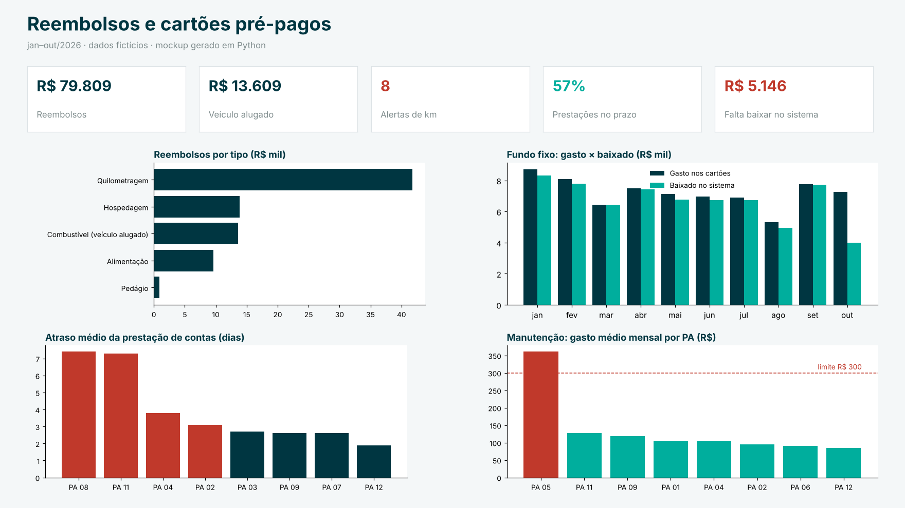

# Painel de reembolsos e cartões pré-pagos

  

Painel de acompanhamento de uma **plataforma de despesas corporativas**. Ele cobre os reembolsos de colaboradores (inclusive viagens com **veículo alugado**) e os **cartões pré-pagos** que cada PA usa para pequenas compras. Também mostra a **prestação de contas** mensal e a **conciliação do fundo fixo**, ou seja, o que foi creditado na plataforma, o que já foi baixado no sistema contábil e o que ainda falta baixar.

> **Dados fictícios**, gerados por `scripts/gerar_dados.py`. A plataforma, os PAs e os colaboradores ("Colaborador A", "Colaborador B"…) não são reais.


*Mockup gerado em Python com os dados processados (`scripts/mockup.py`).*

## Regras de negócio

| Regra | Implementação |
|---|---|
| Reembolso de **quilometragem** = km × tarifa (R$ 1,20/km, parâmetro fictício) | `alerta_km` quando o valor pedido difere do esperado |
| Pedido de reembolso deve ser enviado em até **30 dias** da despesa | `fora_do_prazo_envio` |
| Do crédito mensal de cada cartão, **R$ 300 são para manutenção**; o restante é despesa administrativa | `fUsoManutencao`: gasto × limite e excedente por PA/mês |
| **Prestação de contas até o dia 15** do mês seguinte; o atraso conta a partir daí | `fPrestacao`: no prazo / enviada com atraso / pendente (atrasada) / aguardando |
| Fundo fixo: créditos à plataforma − devoluções − baixas no sistema = **saldo a regularizar** | `fFundoFixo` por competência, com saldo acumulado |
| Cada compra do cartão precisa ser **baixada** no sistema contábil | `fCompraCartao[situacao_baixa]`: "Baixada" ou "Falta baixar" |

## Arquitetura

```
data/bruto/*.csv ──► src/despesas/regras.py (pandas, testado) ──► data/processado/*.csv ──► Power BI
                     limites, prazos, conciliação                  fReembolso, fCompraCartao,      powerquery/*.pq
                                                                   fUsoManutencao, fPrestacao,     dax/medidas.dax
                                                                   fFundoFixo, fCredito
```

As regras de negócio ficam **em Python, com testes**, e não espalhadas em colunas calculadas DAX. O Power BI recebe tabelas prontas e cuida só de agregar e visualizar. Se uma regra mudar (por exemplo, o limite de manutenção), altera-se uma constante e os testes confirmam o impacto.

**Modelo no Power BI:** dimensões `dCompetencia` (AAAA-MM) e `dPA` ligadas a todos os fatos, em direção única; medidas em [`dax/medidas.dax`](dax/medidas.dax).

## Resultado com os dados de exemplo

```
Reembolsos: 420 | R$ 79.808,94 | alertas de km: 8 | fora do prazo de envio: 44
PA/mês que estouraram o limite de manutenção: 8 (PAs: 05)
Prestações: no prazo 63 | enviada com atraso 48 | aguardando (no prazo) 9
Falta baixar no sistema: R$ 5.145,84
```

O PA 05, que estoura o limite de manutenção, e os PAs 08 e 11, que atrasam a prestação de contas, foram **plantados** no gerador. Os testes garantem que as regras os encontram.

## Como abrir no Power BI Desktop

O projeto está em [`pbip/`](pbip) no formato **Power BI Project (PBIP)**: modelo e relatório em texto, gerados por `scripts/gerar_pbip.py`. Abra `pbip/ReembolsosCartoes.pbip`, aponte o parâmetro **PastaProcessado** para `data\processado\` do seu clone e clique em **Atualizar**. São 4 páginas: Reembolsos, Cartões e manutenção, Prestação de contas e Fundo fixo. Para ter um `.pbix`, use *Arquivo › Salvar como*.

## Como executar

```bash
pip install -r requirements.txt
python scripts/gerar_dados.py              # data/bruto/
PYTHONPATH=src python -m despesas          # data/processado/ (entrada do Power BI)
python scripts/mockup.py                   # docs/mockup.png
pytest -q
```

## Stack

Python (pandas, matplotlib) · Power BI (Power Query M, DAX) · pytest · GitHub Actions

---
Autor: **Gabriel Antônio Ribeiro**, Analista Financeiro · [LinkedIn](https://www.linkedin.com/in/gabriel-ant%C3%B4nio-ribeiro-017808210)
